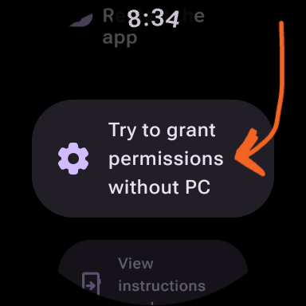
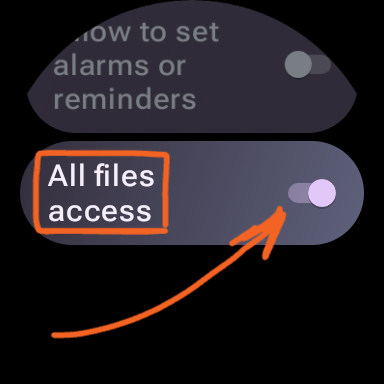

# Frequently Asked Questions

Here is a list of popular questions and answers to them.

### I found a bug / want to suggest an idea.
You can open an issue, and we also have a [Telegram chat](https://t.me/wearfiles_app).

### Transferring files from smartphone to watch

> [!WARNING]
> **File transfer will be unavailable on devices without Google Play services.**

You can transfer files from a smartphone to a watch. You can find the received files in the app on the watch in the "Received" section.

For file transfer to work:

1. Make sure that Google Play services are present on both the smartphone and the watch and updated to the latest version.

2. Install the WearFiles app on the smartphone and on the watch.

    Both apps must be downloaded from the same source.  
    For example, if the app on the smartphone is downloaded from Google Play, the app on the watch must also be downloaded from Google Play.

### "Storage" section

To use the app on the watch as a file manager, you need to grant permission to access files: `MANAGE_EXTERNAL_STORAGE`. Due to Wear OS platform limitations, on some devices this permission cannot be granted directly in the UI.

First, check if this permission is available in settings:

  
    
   

If there is no option in settings to grant permission to access all files, you can use ADB:
1. Connect the watch to a computer via ADB
2. Run the command:  
   ``adb shell appops set --uid com.dertefter.wearfiles MANAGE_EXTERNAL_STORAGE allow``
3. Restart the app
