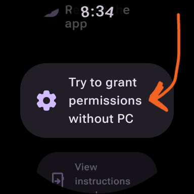
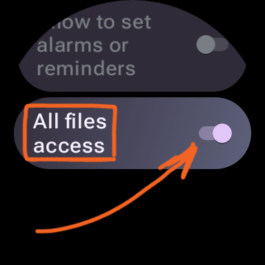

# Часто задаваемые вопросы

Здесь собран список популярных вопросов и ответов на них.

### Я нашёл ошибку/хочу предложить идею.
Можете оставить issue, а ещё у нас есть [Telegram-чатик](https://t.me/wearfiles_app).

### Передача файлов со смартфона на часы

> [!WARNING]
> **На устройствах без сервисов Google Play передача файлов будет недоступна.**

Вы можете передавать файлы со смартфона на часы. Полученные файлы вы найдёте в приложении на часах в разделе "Получено".

Для того чтобы передача файлов работала: 

1. Убедитесь в том, что на смартфоне и на часах есть сервисы Google Play и они обновлены до последней версии

2. Установите приложение WearFiles на смартфон и на часы.

    Оба приложения должны быть скачаны из одного источника.  
    Например, если на смартфоне приложение скачано из Google Play, на часах приложение тоже должно быть скачано из Google Play.

### Раздел "Память устройства"

Чтобы использовать приложение на часах как файловый менеджер вам необходимо выдать разрешение на доступ к файлам: `MANAGE_EXTERNAL_STORAGE`. Из-за ограничений платформы Wear OS на некоторых устройствах это разрешение нельзя выдать просто так.

Для начала проверьте, есть ли это разрешение в настройках:

  
    
   

Если в настройках нет возможности выдать разрешение на доступ ко всем файлам, вы можете воспользоваться ADB:
1. Подключите часы к компьютеру через ADB
2. Выполните команду:  
   ``adb shell appops set --uid com.dertefter.wearfiles MANAGE_EXTERNAL_STORAGE allow``
3. Перезапустите приложение

