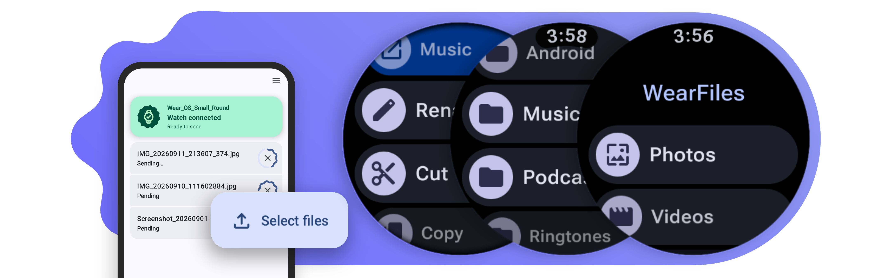
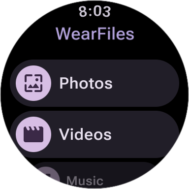
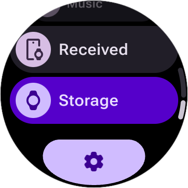
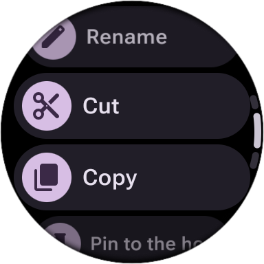
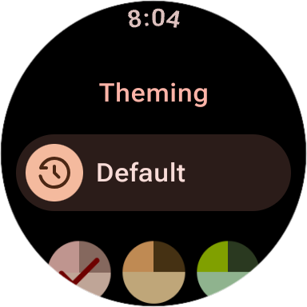

  
  

  

  
  
  
  

# WearFiles

Простой файловый менеджер с открытым исходным кодом. Разработан для Wear OS ⌚

### Возможности приложения:

- Передача файлов с телефона на часы ⌚➡️📱
- Просмотр, открытие, удаление файлов на устройстве Wear OS 📂
- Буфер обмена: вырезать / копировать / вставить 📋
- Закрепление файлов и папок на главном экране 📌
- Встроенный просмотрщик изображений 🖼️
- Встроенный просмотрщик PDF 📄

### Скриншоты

  
    
    
    
  

### [FAQ](FAQ_RU.md)
- О передаче файлов со смартфона на часы
- Доступ к разделу «Storage» (Память устройства)

### Поддержать проект 💰:
[https://dalink.to/dertefter](https://dalink.to/dertefter)

### Звёздочки

<a href="https://www.star-history.com/?repos=dertefter%2Fwearfiles&type=date&releases=&legend=bottom-right">
 <picture>
   <source media="(prefers-color-scheme: dark)" srcset="https://api.star-history.com/chart?repos=dertefter/wearfiles&type=date&theme=dark&legend=bottom-right" />
   <source media="(prefers-color-scheme: light)" srcset="https://api.star-history.com/chart?repos=dertefter/wearfiles&type=date&legend=bottom-right" />
   
 </picture>
</a>